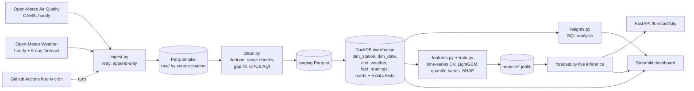

# Urban Air Quality Intelligence Platform

End-to-end data project covering **data engineering → analysis → data science** for 10 Indian cities:
an automated hourly pipeline, a DuckDB warehouse, a Streamlit dashboard, and LightGBM forecasts of
CPCB AQI at **+24 / +48 / +72 h** with SHAP explanations, served through FastAPI.



## Quick start

```bash
pip install -r requirements.txt
export PYTHONPATH=src            # Windows PowerShell: $env:PYTHONPATH="src"
python -m aqip all               # ingest (2 years) -> clean -> warehouse+tests -> insights -> train
streamlit run app/streamlit_app.py
uvicorn aqip.api:app --reload    # then GET http://localhost:8000/forecast/Delhi
pytest
```

Windows: if the checkout path is long, Parquet partition folders can exceed the path limit.
Set `AQIP_HOME=C:\aqip` to put generated data/models/reports in a short path.

## Phase 1: Data engineering

| Step | Module | What it does |
|---|---|---|
| Ingest | `ingest.py` | Hourly air quality + weather per city; exponential-backoff retries; append-only, timestamped Parquet files (replayable); `--incremental` pulls the last 7 days |
| Clean | `clean.py` | Latest-ingest-wins dedupe, physical range checks, full hourly index, interpolates gaps of at most 6 h (flagged `*_imputed`), longer outages stay missing |
| Model | `sql/*.sql` | Star schema: `fact_readings` (station-hour), `dim_station`, `dim_date` (season, festival flags), `dim_weather`; marts `mart_hourly`, `mart_daily` |
| Test | `warehouse.py` | 5 SQL data-quality tests run on every build (duplicates, orphan keys, AQI range, PM2.5 ≤ PM10, coverage) |
| Schedule | `.github/workflows/pipeline.yml` | Tests, then hourly incremental refresh |

dbt/Airflow were left out on purpose: DuckDB SQL models run in a plain Python process, which keeps the
project runnable with `pip install` alone. The `sql/` files are dbt-compatible `SELECT`s if you want to port them.

## Phase 2: Analysis

`python -m aqip insights` writes `reports/insights.md`; every figure is computed from the warehouse
(city ranking, WHO-guideline exceedance, seasonality, festival windows, wind and rain effects, hourly profile).
The dashboard adds a city map, trends, a seasonal heatmap and 30-day WHO-exceedance alerts.

## Phase 3: Forecasting

* **Target:** CPCB AQI (max sub-index, 24 h trailing means for particulates) at t+h.
* **Features:** current pollutants, AQI lags (1 h to 7 d), rolling means, weather now, **weather at t+h**, calendar and festival flag of t+h, city. No pollutant value after t is used; `tests/test_core.py` checks this by perturbing the future.
* **Validation:** expanding-window `TimeSeriesSplit` (4 folds, gap = horizon) plus a 45-day final holdout. No random splits.
* **Models:** persistence baseline, Ridge, LightGBM (+ quantile models for an 80% band).

Holdout results (last 45 days, MAE in AQI points; lower is better):

| Horizon | Persistence | Ridge | LightGBM | LightGBM RMSE | Right CPCB category |
|---|---|---|---|---|---|
| +24 h | 19.6 | 18.7 | **17.0** | 26.9 | 77% |
| +48 h | 27.1 | 24.8 | **22.1** | 35.0 | 70% |
| +72 h | 31.9 | 27.6 | **24.1** | 38.0 | 68% |

SHAP (24 h model): current AQI dominates, followed by PM10, forecast wind over the target day,
recent AQI lags and forecast rainfall, so weather forecasts do carry real signal.

## Known limitations (read before quoting numbers)

* **Data are modelled, not station readings.** Open-Meteo air quality comes from the CAMS model, chosen because it is free, keyless and global. It smooths over local spikes (for example firework emissions at Diwali), so festival effects look weaker than on CPCB/OpenAQ station data. `ingest.py` is the only source-specific module; swapping in OpenAQ or CPCB (both need a key or portal scrape) leaves the rest unchanged.
* **Weather at t+h is analysis data in training, a forecast at inference**, so reported skill is slightly optimistic.
* **The 80% prediction interval is under-calibrated** (holdout coverage 71% / 65% / 59% at 24/48/72 h). Treat it as a rough range, or add conformal calibration.
* SARIMA and LSTM from the original plan were not built; LightGBM was the strongest practical model and two baselines are included for comparison. NASA FIRMS crop-fire data was left out (needs an API key).
* Festival dates are hard-coded in `config.py`; extend the list as needed.

## Layout

```
src/aqip/   config, aqi, ingest, clean, warehouse, insights, features, train, forecast, api
sql/        warehouse models and marts
app/        Streamlit dashboard
tests/      unit tests (AQI maths, cleaning, leakage, target alignment)
```
